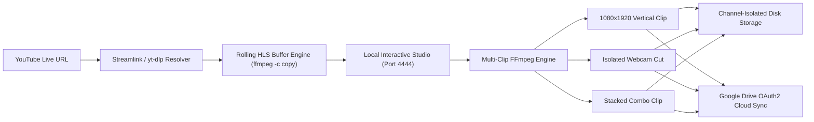

# StreamClipper

[](LICENSE)
[](https://nodejs.org/)
[](https://pnpm.io/)
[](https://www.typescriptlang.org/)
[](https://ffmpeg.org/)
[](CONTRIBUTING.md)

High-performance CLI tool and automated pipeline designed for real-time YouTube live streaming clipping, long-running gaming stream recording (such as GTA 6, esports, and IRL streams), dual 9:16 vertical video conversion, isolated webcam extraction, and instant Google Drive cloud export.

---

## Table of Contents

- [Overview](#overview)
- [Key Features](#key-features)
- [Architecture](#architecture)
- [Keywords & Use Cases](#keywords--use-cases)
- [Prerequisites](#prerequisites)
- [Quick Start](#quick-start)
- [CLI Operating Modes](#cli-operating-modes)
  - [1. On-Demand Single Clip](#1-on-demand-single-clip)
  - [2. Continuous Auto-Clipper](#2-continuous-auto-clipper)
  - [3. Timestamp Range Clipper](#3-timestamp-range-clipper)
- [Storage & Directory Structure](#storage--directory-structure)
- [Hardware Accelerated Transcoding](#hardware-accelerated-transcoding)
- [Interactive Studio Architecture](#interactive-studio-architecture)
- [Google Drive Cloud Setup](#google-drive-cloud-setup)
- [Environment Configuration](#environment-configuration)
- [Full Stack Deployment](#full-stack-deployment)
- [Contributing](#contributing)
- [License](#license)

---

## Overview

StreamClipper solves the latency and storage bottleneck associated with clipping high-bitrate live streams. Traditional workflows require downloading gigabytes of archival footage or re-encoding entire broadcast streams. 

StreamClipper establishes a lightweight, zero-CPU rolling stream buffer directly from YouTube HLS streams. When an interesting event occurs—such as a mission climax in GTA 6 or a tournament clutch—a single CLI command or continuous loop cuts, crops, transposes, and exports production-ready vertical content in seconds.

---

## Key Features

- **Near-Zero Overhead Stream Buffering**: Leverages Streamlink and FFmpeg stream copy mode (`-c copy`) to maintain a rolling disk cache of live segments without transcoding overhead.
- **Multi-Output Single-Pass Transcoding**: A single FFmpeg execution simultaneously extracts three distinct outputs:
  - **Content 9:16 Clip**: 1080x1920 unzoomed vertical format for TikTok, YouTube Shorts, and Instagram Reels.
  - **Webcam Cut**: Isolated, free-size crop centered on the streamer's face camera.
  - **Stacked Video**: 1080x1920 vertical composition placing the gameplay on top and webcam below.
- **Interactive Crop Studio**: Built-in visual studio running locally on port 4444. Allows drag-and-drop bounding box adjustment with live dual previews before initiating encoding.
- **Continuous Auto-Clipping**: Autonomous background loop that cuts sequential stream slices (e.g., every 20 or 30 seconds) continuously throughout the broadcast.
- **Hardware Acceleration Cascade**: Automatically detects and leverages NVIDIA NVENC, Intel QuickSync (QSV), Apple VideoToolbox, or optimized multi-threaded libx264.
- **Automated Cloud Organization**: Synchronizes clips directly to Google Drive structured into `StreamClipper / {Channel Name} / {Stream Title}_{Date} /` directories.

---

## Architecture



### Monorepo Structure

```
streamclipper/
├── apps/
│   ├── worker/       # Node.js service (FFmpeg, buffer manager, CLI suite)
│   ├── web/          # React 19 dashboard (Vite, TailwindCSS v4, Konva)
│   └── api/          # Hono.js edge API on Cloudflare Workers
├── packages/
│   └── shared/       # Normalized math, coordinate converters, shared types
├── clips/            # Local export directory organized by channel
└── buffers/          # Ephemeral rolling HLS stream chunks
```

---

## Keywords & Use Cases

| Category | Keywords | Application |
|---|---|---|
| **Gaming & Events** | GTA 6 clipping, GTA VI stream recorder, esports highlights, speedrun clipper | Instant highlight capture during live gaming broadcasts |
| **Platform Integration** | YouTube live streaming clipping, YouTube Shorts clipper, TikTok reels automation | Repurposing 16:9 horizontal streams into 9:16 vertical shorts |
| **CLI & Automation** | CLI stream clipper, headless stream recorder, continuous video cutter | Server-side automated clipping with zero manual intervention |
| **Video Engineering** | FFmpeg rolling buffer, streamlink pipeline, hardware nvenc transcoding | High-throughput video processing with minimal CPU utilization |

---

## Prerequisites

Before running StreamClipper, ensure the following dependencies are installed and available on your system `PATH`:

- **Node.js**: Version 20.0.0 or higher
- **pnpm**: Version 9.0.0 or higher
- **FFmpeg & FFprobe**: Version 6.0 or higher (with hardware acceleration libraries enabled)
- **Streamlink**: Recommended for YouTube HLS manifest resolution (`pip install streamlink`)
- **yt-dlp**: Fallback stream extractor (`pip install yt-dlp`)

Verify binary availability:

```bash
ffmpeg -version
streamlink --version
node -v
pnpm -v
```

---

## Quick Start

```bash
# 1. Clone the repository
git clone https://github.com/tech-anupam/StreamClipper.git
cd StreamClipper

# 2. Install workspace dependencies
pnpm install

# 3. Configure environment variables
cp .env.example .env

# 4. Build shared modules
pnpm build:shared

# 5. Run a test clip
pnpm clip "https://www.youtube.com/watch?v=YOUR_STREAM_ID" 20
```

---

## CLI Operating Modes

StreamClipper provides three specialized command-line interfaces for stream capture:

### 1. On-Demand Single Clip

Captures the most recent N seconds from the active stream buffer and launches the visual crop studio:

```bash
pnpm clip "<YOUTUBE_LIVE_URL>" [duration_seconds]

# Example: Clip last 20 seconds from a live broadcast
pnpm clip "https://www.youtube.com/watch?v=WwPYtZwsZHU" 20
```

### 2. Continuous Auto-Clipper

Enters a non-stop recording loop. Every N seconds, the tool extracts the buffered slice, re-encodes the dual formats, writes to disk, and immediately begins buffering the subsequent segment:

```bash
pnpm clip:auto "<YOUTUBE_LIVE_URL>" [interval_seconds]

# Example: Continuously cut and save 30-second clips
pnpm clip:auto "https://www.youtube.com/watch?v=WwPYtZwsZHU" 30
```

*Note: Press `Ctrl+C` to gracefully terminate the loop. StreamClipper will flush the active write, clean up temporary buffer segments, and output a session summary.*

### 3. Timestamp Range Clipper

Extracts a targeted time offset directly from a live broadcast or past live stream (VOD):

```bash
pnpm clip:time "<YOUTUBE_URL>" <start_timestamp> <duration_or_end>

# Example: Cut 30 seconds beginning at offset 00:15:00
pnpm clip:time "https://www.youtube.com/watch?v=WwPYtZwsZHU" 00:15:00 30
```

---

## Storage & Directory Structure

Generated clips are organized hierarchically by channel name and sanitized stream title, preventing collisions across multi-stream sessions:

```
clips/
└── {Channel_Name}/
    └── {Stream_Title}_{Date}/
        ├── clip_001_content_9x16_20s.mp4   # Unzoomed 9:16 vertical video (1080x1920)
        ├── clip_001_webcam_20s.mp4         # Isolated webcam cut (1080px width)
        ├── clip_001_stacked_9x16_20s.mp4   # Top gameplay + bottom webcam composition
        ├── clip_002_content_9x16_20s.mp4
        ├── clip_002_webcam_20s.mp4
        └── clip_002_stacked_9x16_20s.mp4
```

---

## Hardware Accelerated Transcoding

StreamClipper interrogates the host FFmpeg build during startup and chooses the highest-priority hardware video encoder:

```
NVIDIA NVENC (h264_nvenc)
  └─► Intel QuickSync (h264_qsv)
        └─► Apple VideoToolbox (h264_videotoolbox)
              └─► Software fallback (libx264 -preset veryfast -crf 23)
```

Hardware acceleration reduces transcode latency to a fraction of playback time, permitting real-time multi-stream throughput on standard workstations.

---

## Interactive Studio Architecture

When running in preview mode, StreamClipper starts an ephemeral HTTP server on `http://localhost:4444` displaying a captured stream frame:

- **Full Stream Mode (Default)**: Locks content coordinates to `100% x 100%` with pointer pass-through, guaranteeing zero accidental cropping or magnification of the gameplay.
- **Custom Crop Mode**: Enables four-corner handles for selective focal area cropping.
- **Webcam Box**: Yellow draggable and resizable selector positioned over the broadcast camera.
- **Dual Live Output Previews**:
  - Mockup 1: Real-time simulation of the 1080x1920 unzoomed fit.
  - Mockup 2: Isolated webcam cut dimensions.
- **Confirmation Endpoint**: Dispatches configuration payload via POST `/api/confirm` and signals the worker process to begin re-encoding.

---

## Google Drive Cloud Setup

To enable automated synchronization to Google Drive:

1. Open the [Google Cloud Console](https://console.cloud.google.com/).
2. Create a project and enable the **Google Drive API**.
3. Configure OAuth Consent Screen and create **OAuth 2.0 Client IDs** (Application type: Desktop App).
4. Generate a refresh token with scope `https://www.googleapis.com/auth/drive.file`.
5. Populate credentials in `.env`:

```env
STORAGE_MODE=gdrive
GOOGLE_CLIENT_ID=your_client_id.apps.googleusercontent.com
GOOGLE_CLIENT_SECRET=your_client_secret
GOOGLE_REFRESH_TOKEN=your_refresh_token
GDRIVE_ROOT_FOLDER=StreamClipper
```

---

## Environment Configuration

| Variable | Type | Default | Description |
|---|---|---|---|
| `STORAGE_MODE` | String | `local` | Clip destination: `local` or `gdrive` |
| `LOCAL_CLIPS_DIR` | String | `./clips` | Directory path for local clip exports |
| `BUFFER_SECONDS` | Number | `600` | Rolling cache duration in seconds |
| `BUFFER_DISK_CAP_MB` | Number | `2048` | Maximum cache size before pruning oldest chunks |
| `MAX_CLIP_SECONDS` | Number | `120` | Upper limit for individual clip duration |
| `FFMPEG_PATH` | String | `ffmpeg` | Absolute path or binary name for FFmpeg |
| `FFPROBE_PATH` | String | `ffprobe` | Absolute path or binary name for FFprobe |
| `STREAMLINK_PATH` | String | `streamlink` | Path or binary name for Streamlink |
| `YT_DLP_PATH` | String | `yt-dlp` | Path or binary name for yt-dlp |
| `WORKER_TOKEN` | String | `default_token` | Authentication secret for API to Worker comms |

---

## Full Stack Deployment

To launch the full distributed architecture (Frontend Dashboard, Edge API, and Worker):

```bash
# Terminal 1: Worker engine
pnpm dev:worker

# Terminal 2: Edge API service (Cloudflare Wrangler)
pnpm dev:api

# Terminal 3: Web Dashboard (React 19)
pnpm dev:web
```

---

## Contributing

Contributions to StreamClipper are welcome. Please adhere to the following workflow:

### Development Workflow

1. **Fork the Repository**: Create an independent fork under your GitHub account.
2. **Create a Feature Branch**:
   ```bash
   git checkout -b feature/hardware-av1-encoder
   ```
3. **Adhere to Code Standards**:
   - Write strict TypeScript with explicit interfaces.
   - Maintain unit test coverage in `packages/shared/src/crop-math.test.ts`.
   - Never commit binaries, `.mp4` recordings, or stream chunks.
4. **Run Validation Checks**:
   ```bash
   # Run unit tests
   pnpm test:shared

   # Rebuild shared packages
   pnpm build:shared

   # Verify typecheck across all workspaces
   pnpm typecheck
   ```
5. **Commit Message Format**:
   Follow conventional commits:
   - `feat: add support for AV1 QSV encoder`
   - `fix: prevent rounding errors in normalized aspect calculation`
   - `docs: update hardware compatibility matrix`
6. **Open a Pull Request**: Submit your pull request against the `main` branch with a description of the changes and testing evidence.

---

## License

This project is licensed under the [MIT License](LICENSE).

---

StreamClipper is intended for archiving and creating derivative content from live streams you own or have explicit authorization to clip. Always respect content creator rights and platform terms of service.
